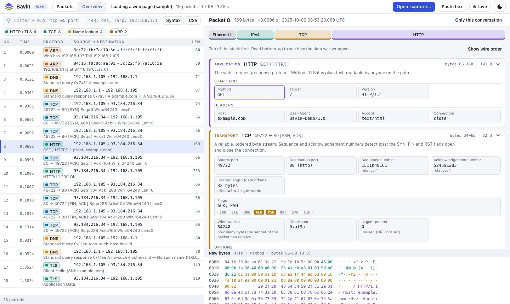
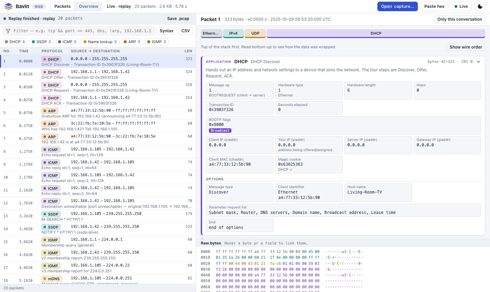
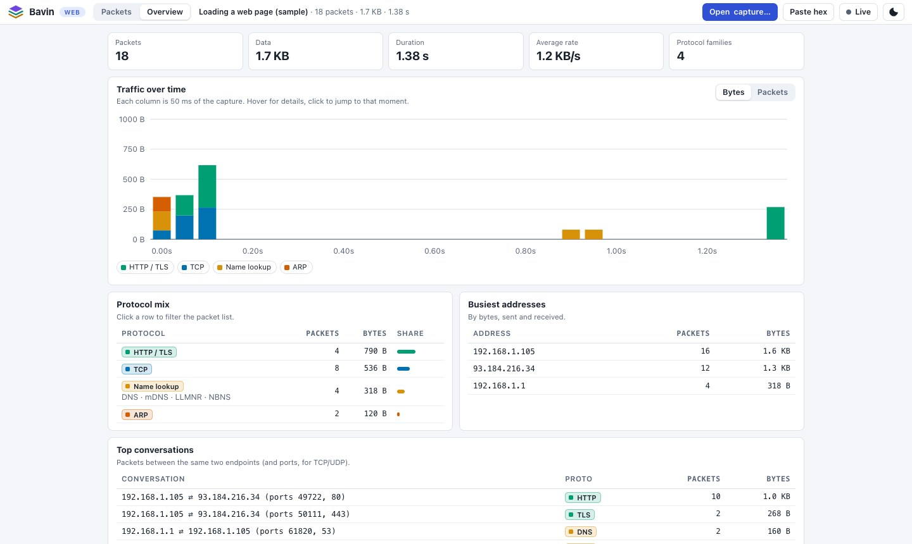

<!-- The panels below are generated SVGs: edit scripts/readme/build-panels.mjs, then `node scripts/readme/build-panels.mjs`. -->

<p align="center"><sub>In the name of God</sub></p>

<p align="center">
  <picture><source media="(prefers-color-scheme: dark)" srcset="docs/assets/hero-dark.svg" /></picture>
</p>

<p align="center">
  <b><a href="https://seyyedkhandon.github.io/bavin/">▶ Try it online</a></b> &nbsp;·&nbsp;
  <a href="docs/GUIDE.md#install-it">Install</a> &nbsp;·&nbsp;
  <a href="docs/GUIDE.md#run-it-locally">Run locally</a> &nbsp;·&nbsp;
  <a href="docs/GUIDE.md">Guide</a> &nbsp;·&nbsp;
  <a href="docs/DEVELOPING.md">Developing</a> &nbsp;·&nbsp;
  <a href="#the-original-desktop-app-c">Desktop app (C#)</a>
</p>

<p align="center">
  <a href="https://github.com/SeyyedKhandon/bavin/actions/workflows/pages.yml"></a>
</p>

<p align="center">
  <picture><source media="(prefers-color-scheme: dark)" srcset="docs/assets/web-dark.jpg" /></picture>
</p>

Bavin is a packet analyzer in the spirit of Wireshark, built for **learning TCP/IP**. Instead of a wall of columns, it shows each packet as a **stack of protocol layers** — Ethernet, IP, TCP or UDP, then the application on top — with every field linked to the exact bytes it came from, so you can read what is happening the way the RFCs describe it.

> **Goal** — help everyone understand the **TCP/IP** protocols in action, based on the IETF specifications, through a *stacked protocol* view of the headers of each well-known protocol.

## Two generations

<p align="center">
  <picture><source media="(prefers-color-scheme: dark)" srcset="docs/assets/compare-dark.svg" /></picture>
</p>

<table align="center">
  <tr>
    <td align="center" width="50%"><b>Then</b> — the Windows desktop app (C#)</td>
    <td align="center" width="50%"><b>Now</b> — the web app</td>
  </tr>
  <tr>
    <td></td>
    <td><picture><source media="(prefers-color-scheme: dark)" srcset="docs/assets/live-dark.jpg" /></picture></td>
  </tr>
</table>

## What you get

<p align="center">
  <picture><source media="(prefers-color-scheme: dark)" srcset="docs/assets/features1-dark.svg" /></picture>
  <picture><source media="(prefers-color-scheme: dark)" srcset="docs/assets/features2-dark.svg" /></picture>
</p>

<p align="center">
  <picture><source media="(prefers-color-scheme: dark)" srcset="docs/assets/overview-dark.jpg" /></picture>
</p>

## Quick start

**Online** — open <https://seyyedkhandon.github.io/bavin/>, click a built-in sample (or drop in a `.pcap` / `.pcapng`), and click around. Nothing is uploaded.

**Install it** — in Chrome or Edge, press **Install** in the top bar (iPhone/iPad: *Share → Add to Home Screen*). It then opens in its own window and works offline.

**Run it locally** — it is plain static files, no build step:

```sh
git clone https://github.com/SeyyedKhandon/bavin.git && cd bavin
python3 -m http.server -d web 8000        # then open http://localhost:8000
```

**Capture your own traffic** — record a file with `sudo tcpdump -i en0 -w capture.pcap` (or Wireshark) and open it, or capture live with the local agent below.

## Live capture

<p align="center">
  <picture><source media="(prefers-color-scheme: dark)" srcset="docs/assets/architecture-dark.svg" /></picture>
</p>

A browser cannot open a network card, so live capture uses a small helper that runs on **your** computer:

```sh
sudo node web/agent/bavin-agent.js        # prints a link — open it, press Live → Start
```

Want the *online* site to use it? Tell the agent to trust that site:

```sh
curl -O https://seyyedkhandon.github.io/bavin/agent/bavin-agent.js     # read it first: it runs with admin rights
sudo node bavin-agent.js --origin https://seyyedkhandon.github.io/bavin/
```

The agent listens on `127.0.0.1` only, requires a private token, and checks `Host` and `Origin`. No privileges? `--replay some.pcap` streams a file as if it were live. Everything is explained in the **[guide](docs/GUIDE.md#live-capture)**.

## Protocols

<p align="center">
  <picture><source media="(prefers-color-scheme: dark)" srcset="docs/assets/protocols-dark.svg" /></picture>
</p>

## Documentation

| | |
| --- | --- |
| **[Guide](docs/GUIDE.md)** | Install, read a packet, three guided labs with the built-in samples, filter cookbook, capturing your own traffic, live capture, deploying, troubleshooting |
| **[Developing](docs/DEVELOPING.md)** | Architecture, adding a protocol, the agent protocol, tests and CI, and regenerating these panels |
| [`web/README.md`](web/README.md) | Reference for the web version: files, security model, deployment |

## The original desktop app (C#)

<details>
<summary><b>Windows desktop version — requirements and how to run</b></summary>

<br>

The original Bavin is a real-time packet analyzer for Windows that decodes every in/out packet from a network interface into a readable stacked `TCP/IP` view. It lives in [`PacketAnalyzer/`](PacketAnalyzer/) and is still the way to sniff live traffic on Windows **without** installing Node.js.

**Protocols (15):** Ethernet, IP, IPv6, ARP, ICMP, UDP, TCP, HTTP, DNS, NBNS, LLMNR, SSDP, IGMP, ICMPv6, DHCP.

**Requirements**
- Windows
- Install [.NET Framework 4](https://dotnet.microsoft.com/en-us/download/dotnet-framework)
- Install the [WinPcap](https://www.winpcap.org/install/) library (an installer is included: [`PacketAnalyzer/WinPcap_4_1_3.exe`](PacketAnalyzer/WinPcap_4_1_3.exe))

**How to run** — open the app, select one interface, and it listens to all in/out packets and shows them to you.

| Step 1 — program started | Step 2 — select a network card | Step 3 — listening |
| --- | --- | --- |
|  |  |  |

Also in that folder: a command-line analyzer ([`CLIPacketAnalyzer/`](PacketAnalyzer/CLIPacketAnalyzer/)) and the C source of the capture DLL. See the readmes there for build notes.

</details>

## License & author

© 2026 [SeyyedKhandon](https://github.com/SeyyedKhandon). The web version in [`web/`](web/) is MIT-licensed ([`web/LICENSE`](web/LICENSE)). The original desktop app in `PacketAnalyzer/` is MIT-licensed ([`PacketAnalyzer/LICENSE`](PacketAnalyzer/LICENSE)) by its original author; the repository's root [`LICENSE`](LICENSE) is GPL-2.0.

<sub>Typography in the panels is [Inter](https://rsms.me/inter/) (SIL Open Font License 1.1), embedded as a subset.</sub>
